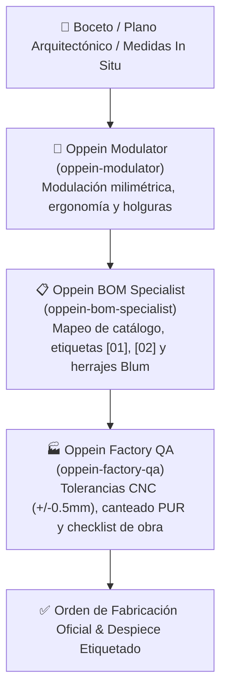

# Protocolo de Operación del Equipo Experto en Oppein
### Modular Architecture & CAD/CAM Production Team

Este documento establece la gobernanza, especialización y flujo de trabajo para el equipo de agentes dedicados a los sistemas de carpintería modular industrial **Oppein**.

---

## 👥 1. El Equipo de Agentes de Oppein

| Agente | Nombre Subagent | Especialidad & Misión |
| :--- | :--- | :--- |
| **Modulador Oppein** | `oppein-modulator` | Ergonomía, modulación milimétrica en múltiplos estándar (150/300/450/600/900 mm), triángulos de trabajo y regletas de ajuste. |
| **Especialista BOM** | `oppein-bom-specialist` | Mapeo de catálogo oficial (`OP-BC-900-2D`, `OP-WC-900-AV`, `OP-TALL-600-OV`), herrajes europeos (Blum/Hettich) y despieces con etiquetas `[01], [02]`. |
| **Control de Calidad** | `oppein-factory-qa` | Tolerancias de mecanizado CNC ($\pm 0.5\text{ mm}$), adhesivo PUR hidrófugo, verificación de plomos y checklist de pre-instalación en obra. |

---

## 📐 2. Estándares Inviolables de Fabricación

1. **Sustratos:** Exclusivamente tableros aglomerados de partículas hidrófugas **MDP P3** (pigmentación verde) clase de emisión **E0**.
2. **Canteado:** 100% encolado con adhesivo de poliuretano reactivo (**PUR**), garantizando cero penetración de vapor o humedad.
3. **Mapeo Unívoco:** Ninguna pieza se envía a producción sin su código de catálogo oficial y sus dimensiones exactas $(W \times D \times H\text{ mm})$.
4. **Despiece Etiquetado:** Todo render o plano técnico debe contar con etiquetas numéricas `[01], [02], [03]` que vinculen visualmente el diseño con la tabla BOM de compra.

