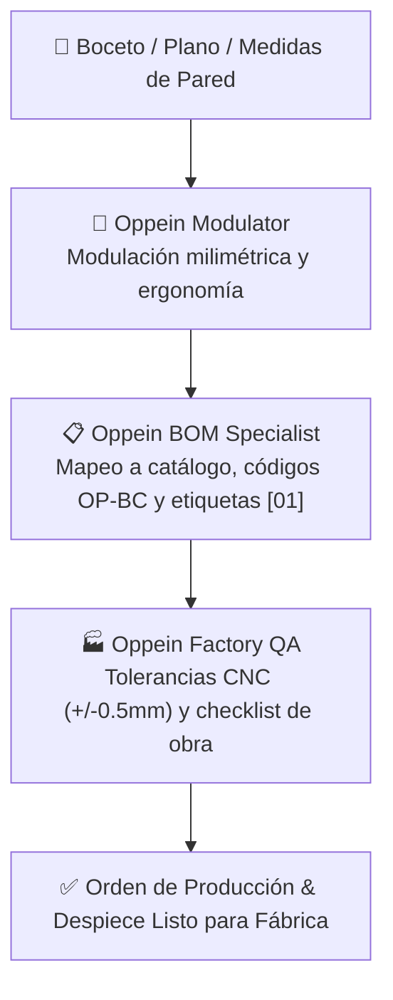

# 📐 Experto en Oppein
### Suite Especializada en Sistemas Modulares, Fabricación Industrial & Despiece Técnico Oppein

Proyecto independiente y especializado al 100% en la modulación milimétrica, especificación de catálogo oficial, despieces técnicos etiquetados y preparación para producción industrial de los sistemas de **Oppein**.

---

## 👥 Equipo Especializado de Agentes

Experto en Oppein cuenta con su propio equipo de agentes dedicados a la precisión milimétrica:



| Rol | Agente | Función |
| :--- | :--- | :--- |
| **Modulador Milimétrico** | `oppein-modulator` | Ergonomía, modulación estándar (múltiplos de 150/300/450/600/900 mm), pasillos de isla y regletas de ajuste. |
| **Especialista BOM** | `oppein-bom-specialist` | Mapeo a catálogo oficial (`OP-BC-900-2D`, `OP-WC-900-AV`, `OP-TALL-600-OV`), herrajes Blum y lista etiquetada `[01], [02]`. |
| **Control de Calidad** | `oppein-factory-qa` | Tolerancias de mecanizado CNC ($\pm 0.5\text{ mm}$), canteado PUR hidrófugo y checklist de plomos en obra. |

---

## 📂 Estructura del Proyecto

```
ExpertoOppein/
├── skills/
│   └── oppein-modular-design/   # 📐 Skill de modulación, algoritmos de ajuste y ergonomía
├── catalogo/
│   └── CATALOGO_PRODUCTOS_OPPEIN.md # 📦 Catálogo oficial (Turing, Bordeaux, vestidores, vanities)
├── templates/
│   └── PLANTILLA_DESPIECE_BOM.md    # 📋 Formato de orden de producción y desglose etiquetado
├── .agents/rules/
│   └── OPPEIN_TEAM.md           # 📜 Reglas de operación del equipo de agentes de Oppein
└── README.md                    # 📖 Esta guía
```

---

## ⌨️ Comandos Rápidos del Experto

| Comando | Acción |
| :--- | :--- |
| **`/oppein kitchen [medidas] [serie]`** | Modula cocina completa (bajos, aéreos, columnas e isla) con serie específica. |
| **`/oppein closet [medidas]`** | Distribuye vestidor con gaveteros, zapateras, barras abatibles y joyero. |
| **`/oppein bom [medidas/boceto]`** | Genera la lista de etiquetas `[01], [02]...`, códigos de producto Oppein y medidas. |
| **`/oppein catalog [mueble]`** | Consulta módulos, herrajes Blum y acabados disponibles para un tipo de mueble. |
| **`/oppein qa [plano/medidas]`** | Ejecuta el checklist de tolerancias y pre-instalación en obra. |

---

## 📄 Licencia y Autoría

Desarrollado con ❤️ por **WilliamAWSOFTWARE (riune)** para profesionales de la carpintería modular y diseño industrial. Licencia MIT.
